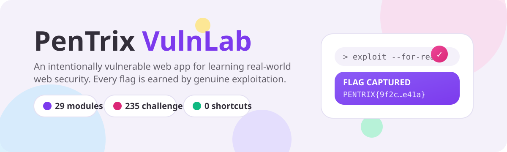
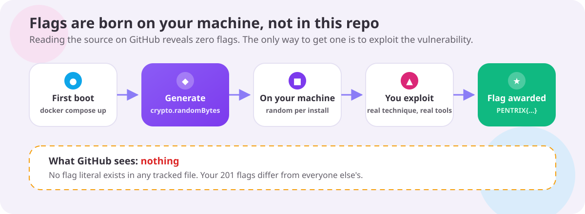
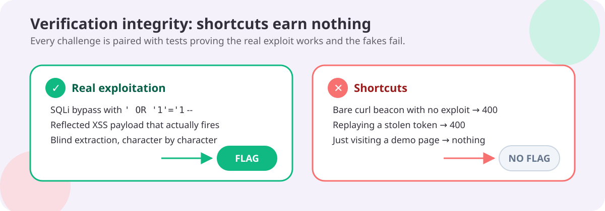
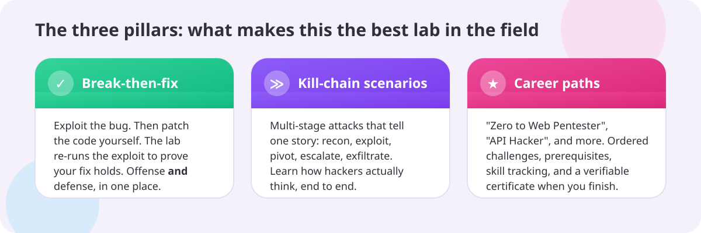
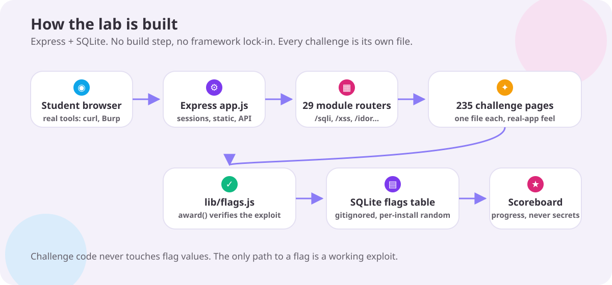

**201 challenges. 29 modules. 3 kill chains. 3 career paths. Zero fake flags.**

PenTrix VulnLab is an intentionally vulnerable web app for learning **real-world web security**, built by **The PenTrix**. Every challenge is a small, believable website with a real bug inside: a shop, a login portal, a blog, an API. Every flag is earned by genuine multi-step exploitation. Nothing leaks from the source, so read all the code you want. The flags are not in it.

🎬 **[Watch the 20-second launch video](https://mizazhaider-ceh.github.io/PenTrix-VulnLab-Website/assets/vid/brag-launch.mp4)**

> ⚠️ **WARNING: This application is intentionally vulnerable.**
> Never deploy it to a public server or expose it to the internet.
> Run it only on your own machine or an isolated lab network.

## Why I built this

I am a cybersecurity student, and I learn by breaking things.

When I started learning web security, the labs let me down. Some handed me the flag just for opening a page. Some taught the theory and skipped the part where you actually exploit something. None of them felt like the real websites I wanted to learn to test.

So I built the lab I wished existed.

Every challenge here is a small, believable website with a real bug in it. No hand-holding, no fake flags, no shortcuts. You exploit it for real, or you get nothing. That is how the real world works, and that is how this lab works.

I built it for students like me: people who learn by doing, late at night, with Burp open, the proxy intercepting, and too much coffee. If that is you, welcome. Break everything.

*Muhammad Izaz Haider ([@mizazhaider-ceh](https://github.com/mizazhaider-ceh))*

## Who this is for

- **Students** meeting web security for the first time who want real practice, not slides.
- **Self-learners** grinding toward pentesting certifications or their first CTF.
- **CTF players** who want 201 warm-up challenges with honest, uncheatable flags.
- **Instructors** who need a one-command classroom lab (event mode is on the way).
- **Career switchers** who want proof of skill: finish paths, earn certificates, show your work.

## Quick start

```bash
docker compose up --build
# open http://localhost:3000
```

The compose file binds to `127.0.0.1` only, ships a healthcheck, drops Linux capabilities, and caps CPU and memory. App data persists in `./data` (gitignored).

Or without Docker (Node 20+):

```bash
npm install
npm start
```

Set `SESSION_SECRET` to a private value for any graded or shared use. Left unset, the app falls back to an insecure dev secret, which is fine for local labs only.

Run the regression suite (490 tests, boots the app on a throwaway database):

```bash
npm test
```

## Recommended tools

This lab teaches **Burp Suite first**. Every challenge falls to the standard Burp workflow: intercept with the Proxy, tamper in the Repeater, automate the boring parts with the Intruder. Burp Community edition clears all 201 challenges. Pro adds Scanner and Collaborator, which you will not need here.

**New to these tools?** Read the step-by-step setup guide: [docs/TOOL_SETUP_GUIDE.md](docs/TOOL_SETUP_GUIDE.md) (install Burp, connect the browser proxy, install the CA certificate, plus ZAP, sqlmap, ffuf, gobuster, and nmap walkthroughs).

| Tool | What it is | Where it shines in this lab |
|---|---|---|
| **Burp Suite** (recommended) | The intercepting proxy, request editor, and fuzzer real pentesters live in | Everywhere. XSS, SQLi, IDOR, SSRF, JWT, auth, race conditions: intercept it, replay it, mutate it |
| **OWASP ZAP** | The free and open-source proxy alternative | Same job as Burp for intercepting and replaying, plus spidering the app before you start a module |
| **sqlmap** | Automated SQL injection exploitation | `sqli` module. Confirm the injection by hand in Burp first, then let sqlmap carry the blind and error-based challenges |
| **ffuf** | Fast web fuzzer | `lfi` path traversal wordlists, `ssrf` blocklist bypasses (decimal, hex, octal encodings), `api` endpoint enumeration |
| **gobuster** | Directory and file brute-forcer | `misconfig` module: hunting exposed `.git`, `.env`, backup and swap files, directory listings |
| **nmap** | Network mapper | Know your target. The lab is localhost-only, so there is little to map, but scanning and fingerprinting belong in every real engagement |

curl still works for quick beacons and one-off requests, but it is no longer the lab's default voice. Reach for curl because the request is simple, not because you skipped learning the proxy.

## How a session goes

1. **Pick a module** on the home page. 29 to choose from, with search and difficulty filters.
2. **Read the briefing**, then open a challenge. Each one looks and behaves like a real little website. The bug is there to be discovered, not announced.
3. **Find the bug.** Exploit it the way a real attacker would: Burp Suite first (Proxy, Repeater, Intruder), your browser, and curl when a quick one-liner earns its keep.
4. **Capture the flag.** It lands on the scoreboard.
5. **Want a story?** Open `/scenarios`: a kill chain of several challenges, stages unlocking one at a time.
6. **Want a career path?** Open `/paths`: ordered challenge sequences from beginner to intermediate, ending in a verifiable certificate.
7. **Stuck?** Reveal the hint. Still stuck? `SOLUTIONS.md` walks the technique, never the flag.

Demoing for a class or a video? [docs/demo-cheat-sheet.md](docs/demo-cheat-sheet.md) packs a five-minute tour.

## Flags are born on your machine, not in this repo



- On first boot, the app generates its own **201 flags** on your machine: `PENTRIX{` + 32 random hex characters.
- **No flag literal exists in any tracked file.** Reading the source on GitHub reveals nothing.
- Your flags differ from everyone else's. Sharing them proves nothing, because only genuine exploits earn flags.

## Shortcuts earn nothing



Flags land only when the exploit genuinely works:

| Real exploitation | Result |
|---|---|
| SQLi login bypass with a working payload | Flag awarded |
| Reflected XSS that actually fires in the victim context | Flag awarded |
| Blind extraction, character by character | Flag awarded |

| Shortcut | Result |
|---|---|
| Bare curl beacon with no exploit behind it | `400`, no flag |
| Replaying a stolen token | `400`, no flag |
| Just visiting a demo page | Nothing |

Every challenge ships with tests proving the real path works and the fakes fail.

## The three pillars



Most labs stop at "find the bug". PenTrix trains complete security engineers:

1. **Break-then-fix.** Capture the flag, then patch the vulnerable code yourself. The lab re-runs the original exploit against your fix in an isolated sandbox. If the exploit fails and the app still works, you earn a fix badge. Offense and defense, in one place. *(In active development: the framework is in-tree, with pilot coverage for sqli and xss first.)*
2. **Kill-chain scenarios.** Multi-stage attacks that tell one story: recon, break in, pivot, escalate, exfiltrate. Single challenges teach techniques; scenarios teach how attackers actually think. Three stories ship today: **Shop Takeover**, **API Heist**, and **Ghost in the CMS**. Each unlocks stage by stage and ends with its own scenario flag.
3. **Guided career paths.** Ordered journeys like **Zero to Web Pentester**, **API Hacker**, and **Authentication Assassin**, with prerequisites, skill tracking, and a verifiable certificate at the finish. Solve every step, download your PNG, prove your skill on any machine running your install.

## Guided career paths

A **career path** is an ordered sequence of challenges that carries you from one skill level to the next. Enter through `/paths`, work the steps in order, capture every flag. Finish all steps and you earn a **certificate**: a downloadable PNG stamped with a verification code (like `PTX-XXXXXXXX`) bound to your install.

| Path | Level | Steps | Prerequisite |
|------|-------|-------|--------------|
| **Zero to Web Pentester** | Beginner | 10: reflected XSS, SQLi login bypass, IDOR, CSRF, debug page leak, HTTP verb tampering, open redirect, CSV formula injection, user enumeration, stored XSS | None. Start here. |
| **API Hacker** | Intermediate | 10: data exposure, mass assignment, missing rate limits, JWT forgery three ways, OAuth flow hijack, API key regeneration abuse, API version bypass, CORS data leak | Zero to Web Pentester |
| **Authentication Assassin** | Intermediate | 11: user enumeration, brute force, reset flow abuse, predictable reset tokens, OTP brute force, security questions, session fixation, predictable sessions, `kid` SQL injection, OAuth code replay, support impersonation | Zero to Web Pentester |

Prerequisites are guidance, not a lock: browse any path's steps anytime, but the paths are designed to be taken in order. Check your code on that path's `/verify` page. Certificates are minted from your install's identity, so a certificate from one machine never validates on another.

## Kill-chain scenarios

Single challenges teach techniques. Scenarios teach how attackers actually think.

A **kill-chain scenario** strings challenges from different modules into one story: recon a target, break in, pivot, escalate, exfiltrate. Enter through `/scenarios` and work the stages in order. Capturing a stage's flag unlocks the next. Capture them all and the **scenario flag** is awarded at the top of the scenario page, generated per install like every other flag.

| Scenario | Story | Stages |
|----------|-------|--------|
| **Shop Takeover** (Intermediate) | Rob the PenTrix Corner Store: pick its locks, abuse its logic, leave your mark. | Pick the Front Lock (SQLi login bypass) -> The Hidden Door (IDOR admin access) -> Pocket Change (price tampering) -> Leave Your Mark (stored XSS) |
| **API Heist** (Intermediate) | Rob Acme Corp's private API: leak data, forge tokens, empty the vault. | The Spill (data exposure) -> The Promotion (mass assignment) -> The Forgery (`alg=none` JWT) -> The Vault (API version bypass) |
| **Ghost in the CMS** (Intermediate) | Slip through a misconfigured CMS unseen, wear another face, haunt the front page. | Dig up the buried past (exposed `.git`) -> Wear someone else's face (predictable reset tokens) -> Plant your shell (upload filter bypass) -> Haunt the front page (stored XSS) |

Lockout is per stage, so leave and come back freely: captured stages stay captured, and the rest wait behind the lock icon until you earn your way in.

## Why PenTrix

| | **PenTrix VulnLab** | Juice Shop | WebGoat | PortSwigger Academy |
|---|---|---|---|---|
| Challenges | 201 | 100+ | Lesson-based | Extensive |
| Flags random per install | Yes | No | No | N/A |
| Shortcut exploits rejected | Yes | Partial | No | Yes |
| Break-then-fix mode | In development | No | No | No |
| Kill-chain scenarios | Yes, 3 story-driven scenarios | No | No | Partial |
| Guided career paths | Yes, 3 paths with verifiable certificates | No | Lessons | Yes |
| One-command local setup | Yes | Yes | Yes | Browser only |
| Fully open source | Yes | Yes | Yes | No |

## Architecture



- **Express + SQLite**, zero build step, plain CSS and JS. Clone it, read it, run it.
- **29 module routers** (`/sqli`, `/xss`, `/idor`, …). One file per challenge: `modules/<id>/challenges/<vuln-id>.js` holds a single challenge, `modules/<id>/index.js` is a thin aggregator, `modules/<id>/shared.js` holds module helpers.
- **`lib/flags.js`** looks up the per-install flag and verifies the exploit before awarding. Challenge code never touches flag values.
- **Scoreboard** tracks progress per browser session. Sessions persist under `data/`, so progress survives restarts. It never displays secrets.
- Every vulnerability is marked in the source with `// VULN:` comments (281 across the codebase). Solve first, then study the code.

## The lab catalog

201 intentionally vulnerable challenges across 29 modules:

| Module | Highlights |
|--------|------------|
| **xss** – Cross-Site Scripting (9) | Reflected · Stored (guestbook, profile bio, SVG upload) · DOM XSS · Attribute and JS-string breakouts · DOM clobbering · Naive Markdown links |
| **sqli** – SQL Injection (11) | Auth bypass · UNION injection · Blind boolean · Error-based · ORDER BY · Second-order · LIKE wildcards · LIMIT/OFFSET · INSERT injection |
| **auth** – Broken Authentication (8) | No rate limiting · JWT `alg=none` · Predictable reset tokens · Username enumeration · Remember-me tampering · OTP brute force · API key in HTML comment |
| **idor** – Broken Access Control (7) | Profile and order IDOR · Invoice download · Cart and address IDOR · API key regeneration · Forced browsing · Comment deletion |
| **ssrf** – Server-Side Request Forgery (9) | Basic SSRF · Blocklist bypasses (decimal, hex, octal, integer IP, userinfo) · Open-redirect chain · Cloud metadata · `file://` |
| **upload** – File Upload (8) | Stored XSS via SVG/HTML · Extension blacklist bypasses (double ext, case, strip-once) · MIME spoofing · Path traversal · Polyglot |
| **cmdi** – Command Injection (9) | Unfiltered ping gadget · Blacklist-bypass series (`$IFS`, `${IFS}`, newline, backticks, glob wildcards, tab, pipe) |
| **xxe** – XXE Injection (8) | File read · SSRF via XXE · Billion laughs · External DTD exfiltration · XXE in SVG/SOAP · XInclude · Parameter-entity OOB |
| **ssti** – Server-Side Template Injection (9) | Basic `{{7*7}}` · Filter-bypass series (words, underscores, brackets, dots, braces, quotes) · SSTI to RCE |
| **lfi** – Path Traversal / LFI (9) | Basic traversal · Filter bypasses (nested, double-encoded) · Absolute paths · Log poisoning · `/proc/self/environ` · Config read |
| **csrf** – CSRF & Open Redirect (5) | State-changing GETs · Login CSRF · JSON CSRF via `text/plain` · Referer/Content-Type bypasses · Method override · 2FA disable via GET |
| **api** – API Security Flaws (5) | Mass assignment · Excessive data exposure · BOLA · Rate-limit bypass via `X-Forwarded-For` · Version bypass · ID enumeration |
| **misconfig** – Security Misconfiguration (10) | Verbose errors · Exposed `.git`/`.env`/backup/swap files · Directory listing · HTTP TRACE · Debug param · Default creds · HTTP PUT |
| **jwt** – JWT Attacks (8) | `alg=none` · Weak HMAC secret · `kid` SQL injection · Untrusted `jku` · RS256/HS256 confusion · Missing expiry/audience checks |
| **session** – Session Management (6) | Fixation · Logout without destruction · Predictable IDs · Session ID in URL · Never-expiring sessions · IDs in debug logs |
| **race** – Race Conditions (8) | Double coupon redeem · Double-spend · Double vote/registration · AV-scan TOCTOU · Rate-limit burst · Stock oversell |
| **bizlogic** – Business Logic Flaws (8) | Negative quantity · Price tampering · Coupon stacking · Client-side OTP · Workflow skipping · Currency confusion · Refund tampering |
| **redirect** – Open Redirect (5) | Protocol-relative `//evil.com` · `javascript:`/`data:` schemes · Backslash bypass · OAuth code theft · Parameter pollution |
| **hostheader** – Host Header Injection (5) | Reset-link poisoning · Cache poisoning · SSRF via Host · `X-Forwarded-Host`/`X-Host-Override` trust |
| **cors** – CORS Misconfiguration (6) | Reflected origin with credentials · `null` origin · Regex bypass · Wildcard on sensitive data · Exposed headers |
| **proto** – Prototype Pollution (6) | Query-string pollution · JSON body pollution · `constructor` bypass · `toString` DoS · Unicode-escape bypass |
| **crypto** – Cryptographic Failures (8) | Predictable PIN · ECB decryption oracle · CBC bit-flipping · Hash length extension · MD5 cracking · XOR crib dragging |
| **oauth** – OAuth Flaws (8) | Redirect-URI bypass · Code leakage · Missing `state` (login CSRF) · Implicit flow · Scope tampering · Code replay · PKCE skip |
| **postmsg** – postMessage Flaws (5) | Missing origin check · Wildcard `targetOrigin` leak · Unsanitized data to HTML · Substring origin bypass · Forged actions |
| **csti** – Client-Side Template Injection (5) | Basic `{{7*7}}` evaluation · Delimiter filter bypass · Constructor breakout · Attribute context · Stored template |
| **http** – HTTP Layer Flaws (3) | CRLF log injection · Method override · Verb tampering · `X-Forwarded-For` trust · Cache deception · Referer auth |
| **jsonp** – JSONP Injection (5) | Callback XSS · JSONP data theft · Callback filter bypass · Array-constructor hijack · MIME sniffing |
| **formula** – CSV Formula Injection (4) | Classic `=cmd` · DDE execution · `HYPERLINK` exfiltration · Pipe prefix |
| **redos** – ReDoS (4) | Catastrophic email/URL regexes · Nested-quantifier username · Regex-injection search |

## What we built

- **Phase Zero, audit.** Live exploitation of the original app, feature inventory, architecture and risk analysis, all in `docs/audit/`.
- **Phase One, planning.** A lab quality matrix grading every challenge, a design brief, a motion system, platform research, and a 10-milestone implementation plan in `docs/roadmap/`.
- **Safety groundwork.** Localhost-only binding, healthcheck, resource limits, non-root image, loader validation, env-based session secret, database untracked.
- **Claymorphism redesign.** A light-only, candy-colored, soft-3D interface: super-rounded cards, squishy buttons, floating blobs, Nunito + DM Sans.
- **Verification integrity.** Every fake flag award removed. Bare beacons, token replays, and visit-only claims get rejected. Only genuine exploits earn flags.
- **Per-install random flags.** Fresh flag values at first boot, on your own machine. GitHub reveals nothing.
- **One file per challenge.** Each of the 201 challenges owns its file, its page, and its code. No monolithic module files.
- **490 regression tests.** The real paths and the fake ones, proven on every run.
- **Break-then-fix mode.** The sandboxed fix runner is in-tree (`lib/fixmode.js`): pilot blocks for sqli and xss let you repair the vulnerable code and prove the exploit dies.
- **Kill-chain scenarios.** Three story-driven scenarios at `/scenarios`: Shop Takeover, API Heist, Ghost in the CMS. Staged unlock, one scenario flag per story.
- **Career paths.** Three guided paths at `/paths`: Zero to Web Pentester, API Hacker, Authentication Assassin. Ordered steps, prerequisites, progress tracking, verifiable PNG certificates.
- The roadmap lives in `docs/roadmap/IMPLEMENTATION_PLAN.md`.

## Project layout

```
PenTrix-VulnLab/
├── app.js                  # Express app, module mounting, scoreboard, about
├── lib/
│   ├── db.js               # SQLite setup and seed
│   ├── flags.js            # flagFor() lookup, award() with exploit verification
│   ├── fixmode.js          # break-then-fix sandbox runner (in development)
│   └── page.js             # shared page shell, nav, scoreboard components
├── modules/
│   ├── sqli/
│   │   ├── index.js        # module contract: id, name, briefing, challenge registry
│   │   └── challenges/
│   │       ├── login.js    # one file per challenge
│   │       └── ...
│   └── ...                 # 28 more modules, same shape
├── scenarios/              # 3 kill-chain scenarios (shop-takeover, api-heist,
│                           #   ghost-in-the-cms), staged unlock, scenario flags
├── paths/                  # 3 career paths (zero-to-web-pentester, api-hacker,
│                           #   authentication-assassin), prerequisites, PNG
│                           #   certificates with verification codes
├── public/                 # claymorphism CSS, client JS
├── data/                   # local app data (gitignored, created on boot)
├── docs/
│   ├── assets/             # diagrams used in this README
│   ├── audit/              # Phase Zero findings
│   ├── curriculum/         # lab quality matrix
│   ├── design/             # design brief, motion system
│   ├── research/           # platform benchmarks, skills research
│   └── roadmap/            # architecture assessment, decisions, plan, progress
├── SOLUTIONS.md            # technique walkthroughs (never flags)
└── docker-compose.yml      # localhost-only, healthchecked, resource-limited
```

## FAQ

**Is it safe to run?**
Yes, on your own machine. The container binds to `127.0.0.1` only, drops Linux capabilities, and is resource-limited. It is still intentionally vulnerable software, so keep it off shared networks.

**Can I put it on the internet so friends can play?**
No. Never. It is a practice target, not a hardened app. For a shared event, run it on an isolated lab network you fully control.

**How do flags work?**
Every install generates its own 201 random flags on first boot, on your machine. The source on GitHub contains zero flags, so nothing can be spoiled by reading code.

**Can I peek at the flags in the code?**
There is nothing to peek at. No flag literal exists in any tracked file. Read the whole repo: you will learn techniques, never flags.

**I solved a challenge but got no flag. Why?**
The lab awards flags for genuine exploitation only. A request that never triggers the vulnerability earns nothing. Re-read the briefing, check the hint, and make the exploit real.

**I found an unintended vulnerability in the lab itself.**
That is a bonus flag in spirit. Open an issue and tell the story.

**Can I add my own challenges?**
A simple challenge-builder format is in development. Until then, issues and pull requests with new challenge ideas are welcome.

**Do I need Burp Suite?**
It is the lab's first-class tool, and I very highly recommend it. All 201 challenges fall to the standard Burp workflow (Proxy, Repeater, Intruder), and the Community edition is enough; you do not need Pro. curl still works for many challenges and your browser handles the rest, but this lab teaches Burp-first: hints and technique walkthroughs name the Burp step, not the curl one-liner.

**Where do I start if I am brand new?**
Open the app and follow the "Start here" card: it points to the gentlest module first. Then take the **Zero to Web Pentester** path at `/paths`: ten steps from gentlest to trickiest, ending with your first certificate.

## Rules

1. Attack **only** this application.
2. Flags prove exploitation. Share write-ups, not just flags.
3. Built for learning. If you find an *unintended* vulnerability, that is a bonus flag in spirit.

## License

Educational use only. Built by The PenTrix.
